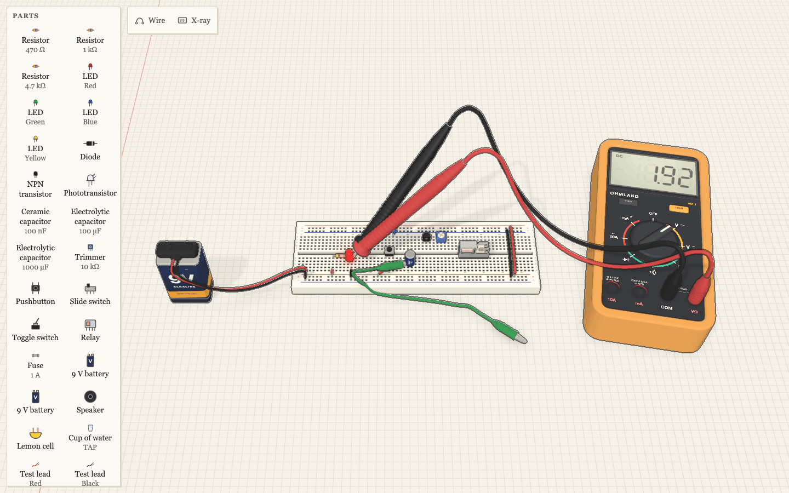
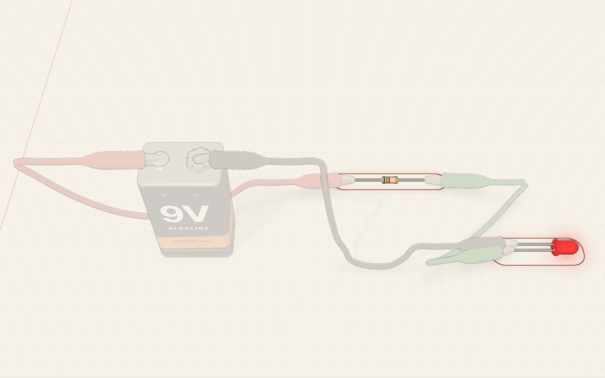
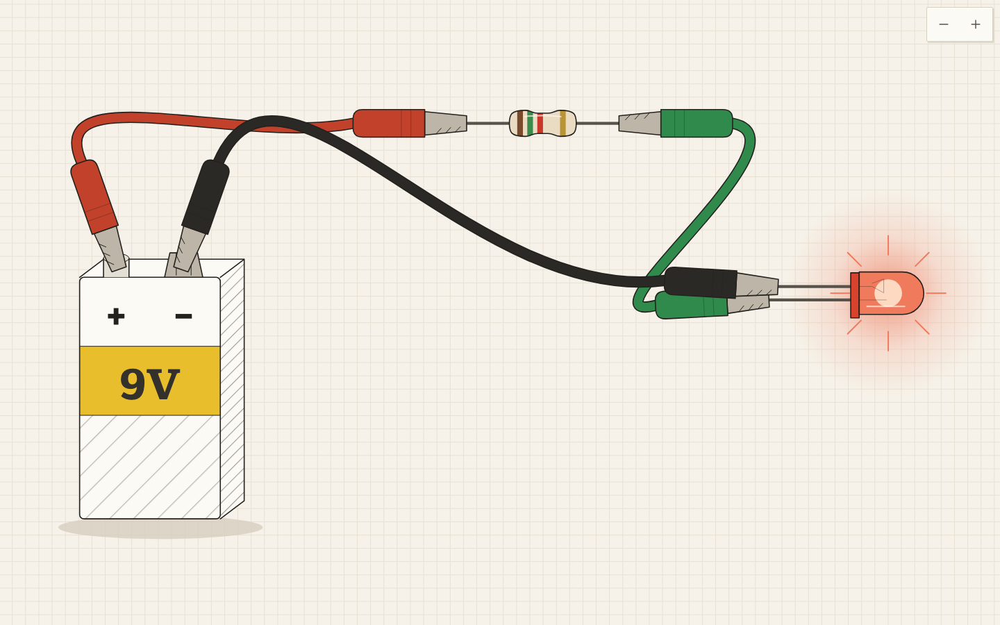
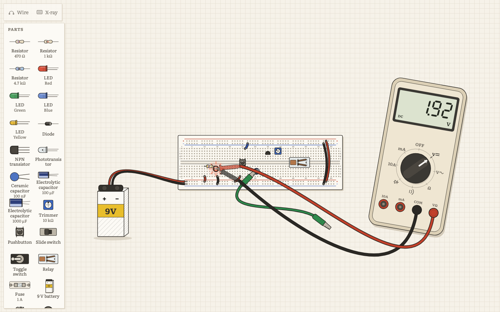
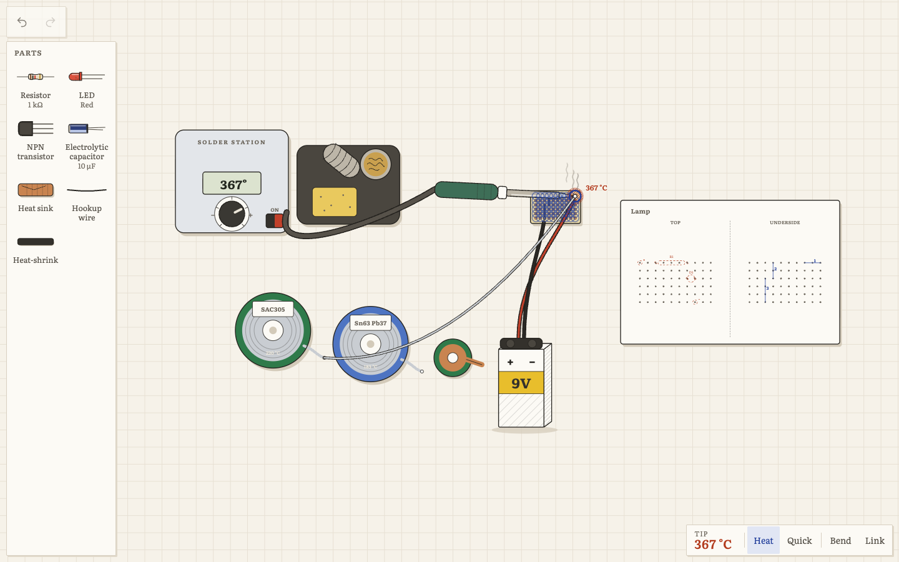
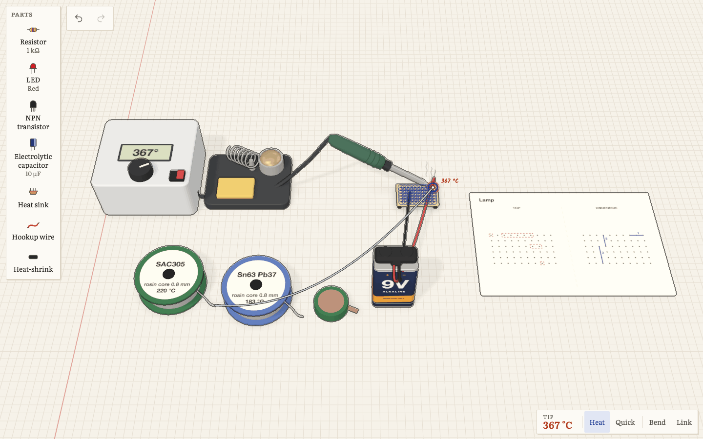
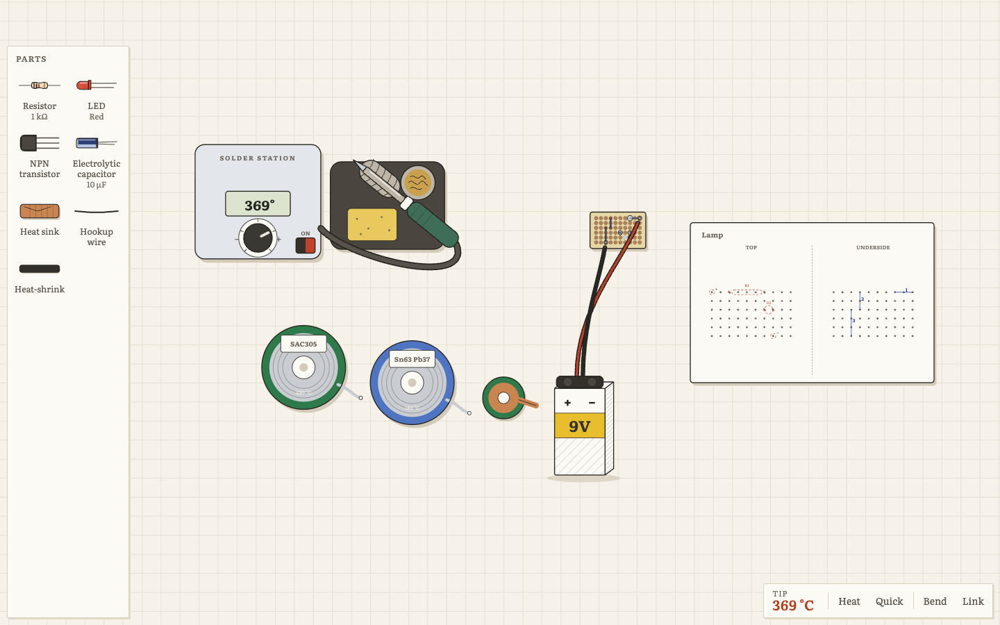
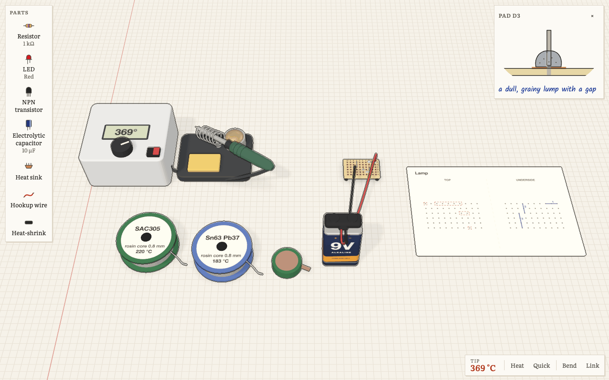
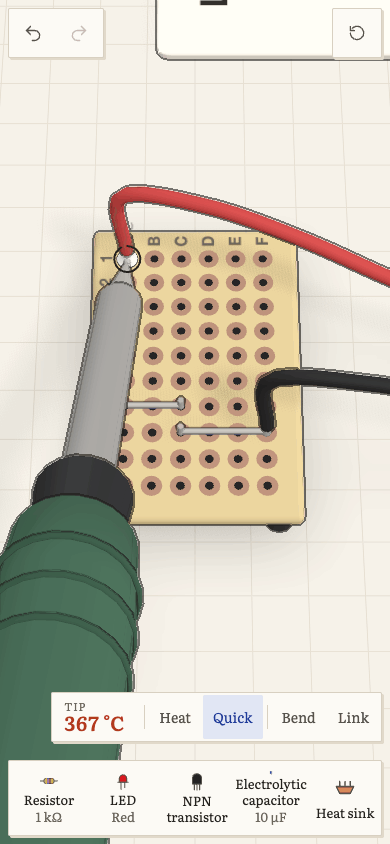
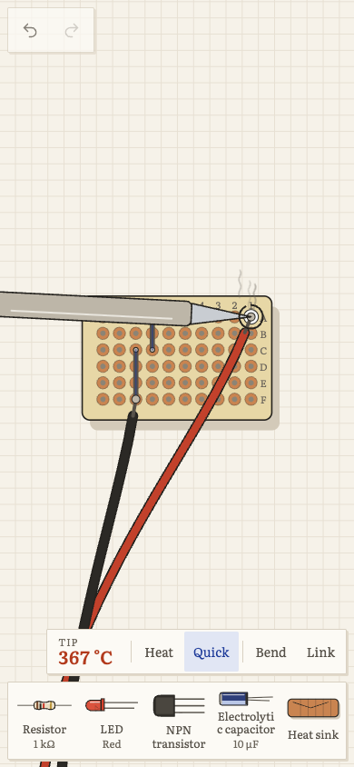

# @ohmland/bench

The lab workbench for Ohmland: a solderless breadboard, procedural part models, a handheld multimeter, mini clip
test leads and jumper wires on a sheet of the notebook's grid paper. Learners drag parts from a tray, snap them into
the board, wire it up and probe it. The simulator (`@ohmland/sim`) drives what they see: LEDs glow, resistors smoke,
fuses blow, relays click, the meter reads.

Two interchangeable views draw the same bench (docs/BENCH-VIEWS.md): the 3D bench on paper (this package's React
Three Fiber scene) and the 2D ink bench (`src/ink`). `<BenchView>` switches between them on one store.

Consumed from source (`"exports"`: `.` everything, `./core` the pure half, `./view` the view switcher and controller
types without three.js, `./ink` the ink renderer alone). Every model is built in code: no downloaded model or image files, no third-party model
libraries.





## Quick start

```tsx
import { Bench, benchToNetlist, emptyBench, type BenchState } from "@ohmland/bench";

function Lab({ sim }) {
  const [snapshot, setSnapshot] = useState(null);
  useEffect(() => sim.onSnapshot(setSnapshot), [sim]);
  return (
    <Bench
      initial={emptyBench({ kind: "bb830" })}
      tray={[{ kind: "resistor", params: { ohms: 470 } }, { kind: "led", params: { color: "red" } }, { kind: "battery", params: { snap: true } }]}
      snapshot={snapshot}
      onChange={(bench) => sim.load(benchToNetlist(bench).netlist)}
      onAction={(a) => a.type === "input" && sim.setInput(a.partId, a.key, a.value)}
    />
  );
}
```

`<Bench />` fills its parent; give the parent a size.

## Two views: `<BenchView>`

```tsx
import { BenchView, type BenchController } from "@ohmland/bench/view"; // no three.js until the 3D view is shown

const ctrl = useRef<BenchController | null>(null);
<BenchView view={settings.benchView === "ink" ? "ink" : "3d"} store={runtime.store} tray={tray} controllerRef={ctrl} />;
ctrl.current?.focus(["part:R1", "part:D1"]);
ctrl.current?.spotlight(["part:D1"]);
```

`BenchView` takes the `<Bench>` props plus `view: "3d" | "ink"` and lazy-loads the renderer (`preloadBenchView(view)`
warms it). It keeps one store for its life, so switching views loses nothing; while the next renderer's code loads,
the current one stays on screen. Its `controllerRef` receives a hub that stays the same object across switches:
overlays subscribe to `onViewChange` once, and the last `focus` and `spotlight` carry over to the new view.
`hub.inner()` is the active view's own controller (in 3D, a `Bench3DController`).

### `BenchController`

| Method | |
|---|---|
| `project(target)` | `{ x, y, visible }` in CSS px relative to the bench element (null for an unknown target). Cheap: call it from every overlay on every view change. |
| `onViewChange(cb)` | Called once per drawn frame in which the camera, the canvas size or the bench changed (so overlays follow drags too). Returns an unsubscribe. |
| `focus(targets, { padding?, instant? })` | Frames the targets from the front (turned a quarter on tall screens when they are wide), with some bench around them; smooth unless reduced motion or `instant`. An empty list frames the work area. |
| `spotlight(targets \| null)` | Lays a veil of the page colour over everything else (their ink fades with it) and rings each target in red pencil. `null` lifts it. |

Targets: `part:D1` (a part, from its rendered model; `part:M1` is the meter), `part:M1/display`, `part:M1/dial`,
`part:M1/com` (any socket), `lead:TL1` and `wire:W1` (whole), and any anchor: `hole:e12`, `pin:R1.a`, `wire:W1.b`,
`lead:TL1.a`, `probe:red`, `socket:com`. `parseTarget` and `targetPoint` (a renderer-free point) are exported for
other views.

`Bench3DController` adds `project([x, y, z])` for world points, `projectClient(target)` (page coordinates, for tests),
`topView()`, `resetView()`, `atHome()`, `pickAt(x, y)` and `stats()` (draw calls of the last frame, all passes).

## Public API

### `<Bench />`

| Prop | Type | |
|---|---|---|
| `initial` | `BenchState` | Starting bench (ignored when `store` is given). |
| `store` | `BenchStore` | Drive the bench from your own store (`createBenchStore`). |
| `tray` | `TrayItem[]` | Parts the learner can drag in. `count` limits how many may be placed; `id` names the placed part when that id is free. |
| `snapshot` | `Snapshot \| null` | Latest simulator snapshot. Reads `glow`, `health`, `closed`, `display`, `unit` per part id. Leave it out when you own the store and set `snapshot` on it yourself (the lab runtime does, 30 times a second, without re-rendering React above the canvas). |
| `onChange` | `(bench) => void` | After every committed change (not during a drag, and not for the initial bench). Rebuild the netlist here. |
| `onAction` | `(action: BenchAction) => void` | Every user action. `type: "input"` actions (pushbutton `pressed`, switch `to`, trimmer `position`, meter `mode`) are meant for `sim.setInput`. |
| `quality` | `"high" \| "low"` | High: ink outlines, bloom, the key light's soft shadow map, DPR up to 2. Low: no post-processing (so no ink lines), contact shadows only, DPR up to 1.5. Both draw the paper and the contact shadows. |
| `readOnly` | `boolean` | Camera only; no tray, no edits. |
| `locked` | `string[]` | Part ids that cannot be moved, rotated or deleted (switches still flip, buttons still press). |
| `highlight` | `string[]` | Part ids (pulsing red pencil frame) or anchors such as `"hole:e12"`, `"pin:R1.a"` (pulsing ring) for lab hints. |
| `labels` | `Partial<BenchLabels>` | Translated UI strings (see `DEFAULT_LABELS`). |
| `camera` | `{ position, target }` | Initial camera; defaults to a framing of the work area (measured from the rendered models on the first frame). |
| `frame` | `[x0, z0, x1, z1] \| null` | Desk rectangle (mm) that the first camera and reset view frame, instead of the whole bench. |
| `theme` | `"light" \| "dark"` | Page colours. By default the bench reads the page's notebook tokens (`--paper`, `--grid`, `--ink`, `--blue`, `--red`, ...) and follows theme changes. |
| `margin` | `boolean` | The notebook's rose margin line, a few cells left of the work area (default true). |
| `controllerRef` | `Ref<BenchController>` | Receives a `Bench3DController` (above). |
| `onReady` | `() => void` | After the first frames have rendered. |

Interaction: drag parts from the tray (or tap a tray item, then tap the bench). Drag a part to move it; its leads snap
into the nearest free holes that fit its footprint, or it lies on the desk. Drag a resistor or diode lead to stretch it
(3 to 8 holes). Wire mode: click a hole then another (or drag between them); pick the colour in the toolbar.
Drag crocodile clips, probe tips and banana plugs; they snap to the nearest lead, terminal, wire end, hole or socket.
Turn the meter dial by dragging it, clicking it (next position) or clicking a label. Hover a hole (or tap it on touch)
to see everything metal-connected to it through the board; the X-ray toggle shows every strip. Right-click or
long-press for a context menu.

Keyboard (the bench is focusable): arrows move the selected part one hole (or turn a selected trimmer, or the meter
dial), `R` rotates, `Delete` removes, `Space` presses a selected pushbutton or flips a switch, `W` wire mode, `X` x-ray,
`T` top view, `Escape` cancels, `Ctrl/Cmd+Z` undo, `Ctrl/Cmd+Shift+Z` redo.

Camera: left drag orbits (limited to the front half and above the desk), right drag pans within the work area, wheel
or pinch zooms toward the cursor. A double click or double tap on a part frames it; on the empty desk it frames the
work area again. The first view, and the view after a resize while the learner has not moved the camera, frames the
work area: the lab's `frame` when it sets one, else the board, the parts, the meter and the leads that hold
something. Rendering is on demand: nothing is drawn while nothing changes, except while smoke or a hint pulse
animates.

Chrome is quiet and appears only when it means something: Wire and X-ray with a breadboard, undo and redo once there is
history, "reset view" once the camera has moved, the selection bar while something is selected, the tray while it
holds something left to place (one column for up to seven items).

### The paper look

- The desk is grid paper drawn in a shader (5 mm cells, about 24 CSS px at a lab's usual framing, rules about one pixel
  wide from any distance) in the page colour exactly: the page is unlit and a tone curve leaves colours below 0.94
  alone. The rose margin line sits left of the work area.
- Light is soft and low in contrast: a strong sky fill, one gentle key light and a cool rim. Materials are made matte
  and slightly quieter as they first appear (`paperizeMaterial`); metals turn a soft pencil grey; resistor bands keep
  their exact colours. Glass is plain see-through plastic.
- Contact shadows under everything on the page and on the board, plus the key light's shadow map on high quality, are
  drawn again only when the bench changes: orbiting the camera redraws neither.
- Ink: on high quality a screen-space pass draws a pen line just outside every silhouette from the depth buffer
  alone (no second render of the scene), 1.6 CSS px wide. It was chosen over inverted hulls from the design study
  (`design/round2/lessons/bench-look`): it looks the same, costs one full-screen pass instead of doubling the draw
  calls, and does not outline each mesh of a part separately.
- Glows are a tinted wash on a light page and add light on the night page (or with the room lights down).

### `benchToNetlist(bench, opts?)`

```ts
const { netlist, nodeOf, warnings } = benchToNetlist(bench);
nodeOf("pin:D1.anode") === nodeOf("pin:B1.pos"); // same node?
```

Union-find over: the five-hole terminal strips (a to e, f to j, the centre channel keeps them apart), the four power
rails (or eight halves with `splitRails`), leads seated in holes, leads joined inside a part (the pushbutton's facing
legs), jumper wire ends, crocodile clips (a lead is one conductor) and meter probes. The meter becomes a `multimeter`
part whose `com`, `vohm`, `ma` and `a10` pins are whatever the plug in that socket reaches through its probe tip; an
empty socket floats. Leads that touch nothing get their own node. The first battery's minus terminal (else the first
lemon cell's) is `"gnd"`. Other nodes are named after what is in them: a strip (`"14a-e"`), a rail (`"tp"`), or a
lead (`"R1.a"`).

Each crocodile lead becomes a simulator `wire` part with `leadOhms` (default 0.15 Ω), so high-current circuits see
realistic totals; its two clips are separate nodes. `benchToNetlist(bench, { leadOhms: 0 })` merges them (an ideal
conductor), which is what topology checks want. Each plugged-in meter probe lead is a `wire` of `probeOhms` (default
0.1 Ω, 0 when `leadOhms` is 0) named `M1:red` / `M1:black`, so touching the tips together reads about 0.2 Ω.
Resistors pass their nominal `ohms`, `tolerance` (percent / 100) and `actualOhms`; capacitors `actualFarads`;
pushbuttons `normallyClosed`.

`warnings` lists problems the learner may need to hear about: `hole-shared` (two leads in one hole), `hole-missing`,
`clip-missing`, `no-ground`.

Part mapping: resistor, led, diode, npn, phototransistor and fuse map one to one; slide and toggle switches are `spdt`;
ceramic and electrolytic capacitors are `capacitor` (`polarized` set); the trimmer is `pot`; the cup of water is
`probe-resistance` (distilled 600 kΩ, tap 30 kΩ, salty 1.2 kΩ); the lemon is a `cell`. The DPDT relay becomes two
simulator relays, `K1` and `K1:2`, whose coils sit in parallel at twice the coil resistance (and inductance) each,
so coil current and pull-in voltage match one real coil; a `poles: 1` relay is one simulator relay. The DPDT switch is a
simulator `dpdt` (two poles on one slider). Touch pads are a `probe-resistance` (a fingertip, 100 kOhm to 2 MOhm, set with the
`ohms` input). A mystery part (`mystery: "31402"`) is wired through its permutation: terminal i is the leg the
permutation names, so the netlist sees the real wiring while the model shows only numbers.

### Lab props (Unit 1)

Desk-only kinds built for the Unit 1 labs, in the same procedural style (`models/LabProps.tsx`):

| Kind | Model | Leads | Simulator |
|---|---|---|---|
| `holder` | Block with two brass spring clips and two screw terminals | `a b` | none: the seated resistor's leads join `a` and `b` |
| `station` | Battery tester: bay, red + and black − posts, a LOAD rocker, the 100 Ω load on show | `a b` | `T1:load` resistor (`loadOhms`) when `load` is on; the seated battery joins `pos`→`a`, `neg`→`b` |
| `fruit` | Lemon half with two slots | none | a `cell` between the two seated electrodes: copper and zinc apart 0.92 V (±0.03, by id) with copper plus, 1.2 kΩ; same metal about 0 V; `touching` 0 V, 1 Ω |
| `electrode` | Copper-plated coin or galvanised strip (`metal`); lies flat, stands upright in a slot | `tip` | none |
| `skin` | Skin pad on a wooden base, scale 0 to 4 cm, moisture tabs (clickable) | `m0` to `m4` | ladder: a contact per mark (dry 400/250 kΩ light/firm, damp 80/50, wet 18/12, salty 4/3) and bulk per cm between marks (20, 10, 5, 2 kΩ) |
| `sample` | Bare copper wire or plastic ruler (`material`) | `a b` | `probe-resistance` 0.02 Ω or 10 TΩ |
| `card` | White card with a ruler, a pencil beside it; drag along the strip to draw | `p0` to `p20` (every 0.5 cm) | ladder over the drawn line: 1 kΩ contact per point, 20 kΩ per cm ÷ layers ÷ 2 if wide; points past the line touch bare card |
| `tag` | Paper value label (`text`) | none | none |
| `bin` | Red reject tray with five seats | none | none |
| `chart` | Colour code card on a stand | none | none |
| `clock` | Desk clock showing simulated hours and minutes | none | none |
| `showcase` | Glass case: a phone Li-ion pack and a model car battery, safety placards | none | none |

`skinOhms(moisture, pressure, cm)` and `pencilOhms(cm, layers, wide)` give the expected values.

**Seats.** A `PartDef` may declare `seats(params)`: named spots that accept kinds, place the held part (`place(held)`
returns its local position and turn) and optionally `joins` its leads to the holder's. Who sits where is
`params.held` (`{ r: "R2" }`), so the bench stays plain JSON. `movePart` seats a part dropped within 16 mm of a seat
(the previous occupant pops out in front), takes it out when dragged away, and keeps seated parts with a moving
holder; `seatPart`, `unseat`, `syncHeld`, `holderOf` and `seatNear` script it. `swapParts(a, b)` and
`dropOnto(id, target, from)` swap two parts' places, seats and attachments; the bench does this when a part is
dropped right on one of its kind.

**Settings, actions, hotspots.** `PartDef.settings` (`{ key, values, also? }`) show on the selection bar as chips or a
select (labels in `BenchLabels.settings`, by `kind.key`); `PartDef.actions` are one-shot buttons (the card's erase);
`PartDef.hotspots(params)` are clickable setting spots or the card's drawing strip (pick types `setting`, `draw`).
`penStroke(base, reach)` is the drawing rule: a first stroke draws from the 0 mark, a stroke over the whole line adds
a layer (up to four) and may extend it.

**Room lights and readouts.** The store's `ambient` (1 to 0.1) dims the lights and background and lifts LED halos;
`inspect: [{ show: "stress" | "heat", parts: [...] }]` floats a stress bar (LED current as a share of `maxmA`) or a
temperature tag with a touch-feel word over every matching part.

`connectivity(bench)` gives the metal-contact groups without building a netlist (used by the x-ray view).

### `@ohmland/bench/core`

The pure half of the package, with no React Three Fiber and no three.js: `benchOps`, `benchToNetlist`,
`connectivity`, anchors, board geometry, `partDef`, `partPose`, `fitCamera`, `createBenchStore` (React and zustand
only) and the types. Lab runtimes import it before the 3D view loads, and headless solution replays and tests use it
in Node.

### Store

`createBenchStore(initial)` returns a zustand store; `useBench(selector)` and `useBenchStore()` read the nearest
`<Bench>`'s store. State: `bench`, `past`/`future` (undo, 100 steps), `snapshot`, `ui` (selection, hover, mode, wire
colour, x-ray, drag state). Actions: `addPart`, `movePart`, `rotatePart`, `removePart`, `setParams`, `addWire`,
`removeWire`, `addLead`, `clipLead`, `removeLead`, `setMeterMode`, `plugProbe`, `touchProbe`, `press`, `undo`, `redo`,
`load`, `apply(fn)` and `begin`/`commit`/`cancel` (drags are one undo step).

The same operations exist as pure functions in `benchOps` (`movePart`, `fitOnBoard`, `moveSpanLeg`, `addWire`,
`clipLead`, `touchProbe`, ...), so a lab can script its solution without React.

### Models and previews

- `<PartPreview kind params state pose spin quality />`: one part on a slow turntable (its own canvas), framed
  automatically. `kind` can also be `"multimeter"` (`params: { mode, display, unit }`).
- `<PartGallery items? />`: every part in rows with name cards.
- For custom R3F scenes: `PartModel`, `MultimeterModel`, `Breadboard`, `AlligatorClip`, `BananaPlug`, `Probe`,
  `JumperWire`, `StudioEnvironment`, `StudioLights`, `Desk`.

Helpers: `resistorBands(ohms, 4 | 5)`, `bandsToOhms`, `formatOhms`, `formatFarads`, `ceramicCode`, `boardGeometry`,
`parseHole`, `holeWorld`, `partPose`, `anchorPosition`, `clipTargets`, `PART_KINDS`, `partDef`, `partLegs(part)` (the
leads a placed part actually has: a single-pole relay has five, a one-throw toggle two), `isThrowSwitch(kind)`.

Mystery parts: `shuffleFor(seed, n)` gives a permutation (never the identity) from any string, `physicalLeg(part,
leg)` is the terminal wired as `leg`, `wiredAs(part, terminal)` the reverse, and `terminalNumber(part, leg)` the
number printed beside a terminal.

## 2D ink view (`<BenchInk />`)

The same bench as a top-down ink drawing on grid paper, in the Classic notebook style: graphite outlines, coloured
pencil washes, blue ink for your selection and red pencil for the teacher's hints. It renders the same `BenchState`
from the same store, emits the same actions through the same `benchOps`, and reads the same simulator snapshots, so
a lab can switch between the 3D and ink views at any moment without losing anything (see `docs/BENCH-VIEWS.md`).
It is plain SVG: nothing under `src/ink` imports three.js (a test walks the import graph to keep it that way).





Use it through `<BenchView view="ink">`, or alone:

```tsx
import { BenchInk } from "@ohmland/bench/ink";

<BenchInk store={store} tray={tray} onAction={onAction} controllerRef={controller} />;
```

Props are `BenchRendererProps`, the same as the 3D `<Bench>`'s (`initial`, `store`, `tray`, `snapshot`, `onChange`,
`onAction`, `quality`, `readOnly`, `locked`, `frame`, `highlight`, `labels`, `theme`, `className`, `style`,
`onReady`, `controllerRef`); `camera` is accepted and ignored. `labels` also takes the ink view's few strings
(`INK_LABELS`: fit, cursor and screen reader lines). `quality: "low"` drops the glow rays. `theme` forces the light
or night page; by default the drawing follows the page's notebook tokens (`--paper`, `--ink`, `--sk-*`...).

**Teaching scale.** Parts on the board are drawn at true size on their holes. Small parts lying on the desk are drawn
larger than life (resistors 2x, LEDs and other radials 1.6x, 1 W resistors 1.35x, power resistors and props at true
size), but every lead, terminal, clip point and socket is exactly where `partPose` and `anchorPosition` put it, so the
drawing shows the connections BenchState holds. A 9 V battery on the desk is drawn standing, terminals on top at their
clip points and its label below; seated in the battery tester it is seen from straight above. A probe resting on
something is held nearly upright, so it is drawn short and see-through.

**Live state.** LED glow (a halo in the LED's colour, rays above 12%, brighter in a dim room), dead parts (cracked and
hatched LEDs and diodes, scorched resistors, a blown fuse's broken filament and smudge, a burst electrolytic), smoke
wisps for `smoking` (still under reduced motion), relay blades that swing from NC to NO with `extra.armature`, the
meter's seven-segment LCD with its unit and DC/AC marks, switch and slider positions, a held pushbutton, the desk
clock, stress and heat readouts (`inspect`) and the room light (`ambient` dims the paper, never the glows).

**Controller** (`InkController`: the shared `BenchController` plus `projectClient(target)`, `resetView()`, `atHome()`,
`pickAt(x, y)` and `camera()`): `project(target)` takes every target in the table above, plus a bare part id (`D1`),
`part:R1/a` (a lead), `part:M1/dialFace` and `part:M1/sockets`, `board` and `strip:14a-e`; `onViewChange(cb)` fires
at most once a frame for a pan, zoom, glide, resize or bench change; `focus(targets, { padding, instant })` glides to
frame them with some bench round them (never tighter than about 24 mm, an empty list frames the work area) and keeps
that framing when the bench resizes; `spotlight(targets)` veils everything else in the page colour (the board less,
as quiet context) and rings the targets in red pencil.

**Interaction**, as in 3D: drag or tap-then-tap from the tray; drag parts (they snap into holes, drop into holders'
seats, or swap with a part of the same kind they are dropped on); drag a resistor's or a capacitor's lead to stretch
it; drag jumper ends, clips, probe tips, banana plugs, the meter and its dial (or click the knob, or a label); click a
switch to flip it, hold a button, turn a trimmer, click a prop's printed setting (moisture tabs, the tester's load
switch), drag along the pencil card to draw; Wire mode for hole to hole jumpers; X-ray; right-click or long-press for
the menu. Hover a hole (or tap it) to light its metal strip and everything joined to it. Empty-paper drags pan; the
wheel, trackpad pinch and two fingers zoom toward the pointer.

**Keyboard.** The bench, every part, clip, probe, plug and the dial are focusable with names (jumpers are reached with
the cursor, so a busy board does not fill the tab order); the focus ring is a dashed blue mark. The 3D view's keys
work (arrows move the selected part a hole, `R`, `Delete`, `Space` flips or presses, `W`, `X`, `Ctrl/Cmd+Z`,
`Ctrl/Cmd+Shift+Z`), plus `+`, `-` and `0` to zoom and fit. With nothing selected the arrows walk a cursor between
holes and leads (screen readers hear the point and what is joined to it); `Enter` on a clip, probe or plug picks it
up, the arrows carry it, `Enter` puts it down, `Delete` leaves it loose and `Escape` cancels. In Wire mode `Enter` on
two holes adds a jumper; an armed tray item is placed with `Enter`.

**Adding a part kind.** Each kind is one entry in the ink registry (`src/ink/kinds`): a `box` (its outline in the
part's frame) and a `Draw` component (top down, millimetres, x right and z down the page), plus an optional
`actuator`, `layer` and `clock`. Leads must end on `localLegs(pi)`. Desk modules (`base: true`) share `TerminalBlock`.
A kind with no entry still works: it is drawn as a labelled slip with its leads, and the ink test fails until it has
a drawing of its own.

**Performance.** Pan and zoom never re-render React: the camera writes one transform per layer, the grid paper's
background, a stroke-width variable and a level of detail (fine print and hole centres appear as they become
readable). The board's 830 holes are one path, drawn once. A part's geometry is cached by identity, so a drag rebuilds
only the moving part, and each part re-renders only when its look changes (glow in 2% steps), so a steady circuit
costs nothing per snapshot. Outlines keep their pen width at every zoom (`vector-effect: non-scaling-stroke`).

## Unit 3: soldering, perfboard, wire and wall power (`src/solder`)

The solder station for docs/curriculum/unit-3.md: an iron that heats over seconds, joints that answer with their shape,
a tug and the meter, heat that creeps up a lead into an LED, pad-per-hole perfboard, hookup wire with a stripper,
heat-shrink with a heat gun, and wall adapters into a barrel-jack board. Everything works and looks the same in the
3D and ink views.





 

 

### Kinds

| Kind | What | Leads | Simulator |
|---|---|---|---|
| `solder-station` | Base (display, dial 150 to 450 °C, power rocker), stand with sponge, brass wool and coil, the iron on its cord. `on`, `setC`, `iron` (where it is: `"stand"`, a spot, `"desk"` with `ironAt`), `tinning`, `spool` | none | none |
| `solder-spool` | A reel with its label; `alloy` `"leaded"` (Sn63 Pb37, 183 °C), `"lead-free"` (SAC305, 217 to 220 °C), `"acid"` | none | none |
| `solder-braid` | Desoldering braid; `used` (0 to 1, the silvered end); action `snip` | none | none |
| `perfboard` | Pad-per-hole board, `cols` x `rows`, pads `A1` (row letter, column number). `flipped` (copper side up: left becomes right), `tack`, `flexed`, `joints`, `bends`, `links`, `plan`, `snipped` | one per pad (`pin:PB1.B4`) | joints and bridges (below) |
| `plan-card` | A plan: `ghosts` (`{ id, kind, legs: { leg: pad } }`) and numbered `lines` (pad pairs); drawn on a card and over its board | none | none |
| `heat-sink-clip` | Copper or steel (`metal`); dragged near a lead it grips it (`on: "D1.anode"`, `mm` from the body) | none | none (heat only) |
| `hookup-wire` | `color`, `awg`, `stranded`, `len`; ends `a` and `b` go into breadboard or perfboard holes; stripped `ends`, every strip in `tries`, splice `joints`; actions `twist`, `snip-a`, `snip-b` | `a b` (one conductor) | splice joints |
| `wire-stripper` | Notches 30 to 16 AWG on a solid and a stranded scale (`notch`, `scale`), jaw stop `stopMm`; action `strip` strips the wire end in its jaws | none | none |
| `heat-shrink` | 2:1 tube, `size` 1.6, 3.2 or 6.4 mm; slid onto a wire only past a free end (`on`, `at`), `shrink` 0 to 1, `split` | none | none |
| `heat-gun` | `on`; its hot air shrinks tubes in front of the nozzle (cooler further away) | none | none |
| `barrel-jack` | A small board with a barrel socket; two pins one hole apart for the rails | `tip sleeve` | (the adapter's supply) |
| `wall-adapter` | `volts`, `amps`, `type` (`"regulated"`, `"unregulated"`, `"ac"`), `centre` (`"plus"`, `"minus"`), `into` (a jack); its barrel plug is a flying lead dragged into a jack | `plug` | `supply` between the jack's pins (centre minus swaps them); unregulated ones read about 1.45 x the label with a 400 µF ripple filter |

Parts go through perfboard holes like breadboard holes: `holes: { anode: "PB1:C7", cathode: "PB1:C8" }`, and dragging
a part over a board (top side up) seats it in the nearest free holes. A part soldered in no longer lifts out. Flipped
over, the board shows its copper: parts are underneath (both views hide them) and only their legs show, mirrored.

### The perfboard's netlist

A leg in a hole touches its pad only through solder. At each pad, everything metal (legs through the hole, legs bent
onto it, link ends) is joined to the pad by the pad's joint: a good joint (and too much solder, a bridge, a burnt joint
whose pad held) is metal; a cold, disturbed or very thin joint is a wire of a few ohms that opens while the board is
`flexed`; a lifted pad is open. A bridge also joins the neighbouring pad and what comes through it. Bare legs or bare
links that cross underneath touch. In `tack` mode legs that meet at a pad conduct without solder (MP10). These are
`PartDef.contacts` (metal) and `toSpecs` (the resistive joints), so `connectivity` and `benchToNetlist` see them.

### The station engine and the overlay

`stepStation(bench, station, dt)` is pure: the iron (a 60 W heater with temperature control: 20 s to 330 °C, still
above 200 °C a minute after switch-off), the joint under it and every live joint (SE2: heat the work through a contact
that a tinned tip and a molten bridge improve, feed solder, wet, set, verdict), heat running up leads into parts with
clips (SE3), tubes in front of the gun, the desk scorching. What lasts goes into BenchState (where the iron rests, a
joint once it sets, a tube's shrink); temperatures and molten solder live in the store's `station`. It returns
simulator inputs (`bodyC` on parts warmed through their leads), which the overlay sends as `input` actions, so a host
that forwards `onAction` inputs to `sim.setInput` needs nothing more.

The solder overlay (`SolderOverlay`, mounted by both renderers, nothing on benches without solder kinds) runs the clock
(the simulator's time when snapshots arrive, so time-lapse cools an iron; else the wall clock; `stationClock` forces
one) and the hands-on part, drawn over either view through its `project()`:

- **Iron**: drag it by its handle and drop the tip on a joint: it rests there. Dropped on the desk it scorches the
  paper, then slides home. **Solder**: drag the spool's free end to the hot joint (or to the tip) and hold to feed.
  **Braid**: drag its end onto a joint, rest the iron on it. **Quick mode** (dock): press and hold a joint; the iron
  rests and feeds once the work is hot; release lifts both, and a ring fills as the solder goes on.
- A **tap** on a joint opens the **magnifier** (the joint side on, named in words); a drag away from it **tugs**.
- **Bend** and **Link** (dock, copper side up): drag from a pad with a leg to another pad to bend the leg, or add a
  bare wire link.
- **Heat view** (dock): ink hatching over everything warm (denser is hotter), with numbers on the tip and warm bodies.
- **Keyboard**: every spot is a focusable button; `I` rests or lifts the iron there, hold `S` to feed, `T` tugs, `M`
  or `Enter` opens the magnifier, `H` heat view, `W` wipes the tip, `Q` quick mode (then hold `Enter` or `Space`).
  Screen readers hear each spot's name, its joint's phase and, once looked at, its shape.

The pure actions are exported for labs and tests: `placeIron`, `holdIron`, `feedAt`, `quickPress`, `tug`, `layBraid`,
`magnify`, `wipe`, `readJoint`, `stationSpots`, `ironPose`. Spots are anchors (`spot:PB1.B4`, `spot:D1.anode`,
`spot:HW1.b`, `spot:ST1.stand`, `spot:ST1.tip`, `spot:SD1.end`), so `project()`, `focus()` and `spotlight()` take them.

### The joint and heat models

Verdicts, checked in order: burnt (above 420 °C, or held molten more than 10 s on a pad, 15 s on wire, 20 s on
14 AWG; a pad lifts 6 s later), bridge, disturbed (moved
while setting), cold (wetted under 0.6, or never 15 °C above the melt), too much (over 1.8 x ideal), too little (under
0.5 x), good. `jointLook` (shape: volcano, ball, ring, lump, frosty, bridge, burnt; finish bright, satin, dull, dark),
`jointElectric` (0.005 Ω sound; cold and disturbed intermittent) and `tugResult` (held, loose, pulled) read the
record. `test/solder-joint.test.ts` checks every calibration row of unit-3.md 3.4 (a crossed pair melts in 2 to 3 s, a
pad in 1 to 2 s, lead-free about 20% slower, an oxidised tip never, 14 AWG in 8 to 12 s, a carried bead balls up cold,
a tug while setting disturbs, extra feed bridges, braid heals, 20 s burns and lifts the pad).

`LeadHeat` is a 1 mm lumped network from the iron (or a hot pad) along each lead to the body, with copper or steel
clips as lumps gripping a segment. With the simulator's LED die model (`ledHeatDim`, `ledHeatRate`), an iron at 330 °C
12 mm down an LED's leg takes a third of its glow at 12 to 18 s and kills it at 25 to 35 s; a copper clip between
keeps it above 0.8 of its glow at 120 s; a steel clip only delays it (dead at 50 to 80 s); 370 °C is about 20% sooner
(`test/solder-station.test.ts` runs it through the simulator). A normal 3 s joint at an LED's pad only warms it; held
far too long it cooks it.

### Wire, tubes, adapters

`stripWire` (notch against the copper: too small nicks or cuts strands, too big slips) and `stripEnd`/`stripNearest`
keep every try. `moveTube` lets a tube onto a wire only past a free end (both ends held: no way on, MP7), `stepTube`
shrinks it with the gun's air (`gunAirC` falls with distance) and splits it if held too hot; `tubeGrips` says whether a
shrunk tube holds what it covers. `movePlug` puts an adapter's plug into the nearest jack's socket.

Playground: `?scene=solder` (`&top=1` the top with the plan's ghosts, `&joints=all|none`, `&lead=leaded`, `&heat=1`,
`&quick=1`), `?scene=heatsink` (`&clip=0`), `?scene=wires`; these scenes run the real simulator in the page.
`pnpm --filter @ohmland/bench shots:solder` drives the flow in both views (mouse, touch, keyboard) and saves the
`solder-*` screenshots.

## BenchState

Plain JSON, millimetres on the desk (x right, z toward the viewer, y up).

```ts
type BenchState = {
  v: 1;
  board: { kind: "bb830" | "bb400"; splitRails?: boolean; pos?: [x, z] } | null;
  parts: {
    id: string;                 // "R1", "D1", "K1"
    kind: BenchPartKind;
    params: PartParamsMap[kind];  // resistor { ohms, bands?, tolerance?, watts? }, led { color, size?, lens? }, ...
    pos: [x, z];                // body position when on the desk
    rot: number;                // degrees (quarter turns on the board)
    holes?: { [lead]: HoleId }; // "a1".."j63", rails "tp3" (far +), "tn3" (far -), "bp3" (near +), "bn3" (near -)
    ends?: { [lead]: [x, z] };  // free ends of flexible leads (battery snap, speaker wires)
  }[];
  wires: { id: string; a: HoleId; b: HoleId; color: WireColor }[];
  leads: { id: string; color: LeadColor; a: LeadEnd; b: LeadEnd }[];   // crocodile test leads
  meter: {
    id: string;                 // "M1"
    pos: [x, z]; rot: number;
    mode: "off" | "dcv" | "acv" | "dca-ma" | "dca-10a" | "ohm" | "continuity" | "diode";
    range?: string;
    probes: { red: MeterProbe; black: MeterProbe };  // { socket: "com" | "vohm" | "ma" | "a10" | null, plugPos, tip: LeadEnd }
  } | null;
};
type LeadEnd = { to: Anchor | null; pos: [x, z] };
// Anchor: "hole:e12" | "pin:R1.a" | "wire:W1.b" | "lead:TL1.a" | "probe:red" | "socket:com"
```

Lead names per part: resistor `a b`; diode and LED `anode cathode`; phototransistor `e c`; npn `e b c` (flat face
toward you, left to right); ceramic `a b`; electrolytic `pos neg`; trimmer `a wiper b`; slide and toggle switches
`a com b`; pushbutton `a1 a2 b1 b2` (a1 and a2 face each other across the channel and are always joined); relay
`coil1 coil2 com1 nc1 no1 com2 nc2 no2` (DIP-16 positions 1, 4, 6, 8 per side; `poles: 1` keeps the first five);
DPDT switch `a1 com1 b1 a2 com2 b2`; fuse, speaker, cup and touch pads `a b`; battery and lemon `pos neg`; lab props
as in the table above.

Footprints (board pitch 2.54 mm): LED and phototransistor 2 adjacent holes; small electrolytics 2 adjacent holes,
8 mm cans and up 2 holes apart; ceramic discs 2 holes apart; transistor, trimmer and slide switch 3 adjacent holes;
toggle switch 3 lugs 2 holes apart; pushbutton 4 legs straddling the channel; relay 8 pins straddling the channel;
fuse clips 4 holes apart; resistor and diode 3 to 8 holes; capacitors bend their legs to `span` holes (1 to 7); touch
pads 2 holes apart.

Desk modules: `base: true` on a pushbutton, slide or toggle switch, trimmer or relay (and every DPDT switch) puts the
part on a wooden block with brass screw terminals for clip leads (`tag` prints a name on its front). Base parts stay on
the desk. A mystery relay or DPDT switch has an opaque cover and numbered terminals; `peek: true` shows the inside.

## Playground

```bash
pnpm --filter @ohmland/bench dev     # vite playground, http://localhost:5199
```

- `/` the demo bench (LED + 470 Ω + 9 V battery on the board, meter across the LED, a test lead) with the full tray
  and a mock snapshot panel: LED glow sliders, health per part, meter display text and unit, relay closed. The panel
  also lists the live netlist and the action log.
- `?scene=clips` a section-one bench with no board, everything joined by crocodile leads; `?scene=smoke` a small
  board with an overloaded resistor; `?scene=empty`, `?scene=half` (400-point board); `?scene=props` every lab
  prop on one desk; `?scene=modules` the desk modules; `?scene=blocks` desk modules, single-pole and mystery relays
  (closed and peeked) and bendable capacitor legs on a half board; `?scene=glow` the first-glow loop (`glow0` before
  it is wired).
- A toggle above the bench switches between the 3D and ink views on the same store, or shows both side by side
  (`view=ink` starts in ink, `view=split` side by side, `toggle=0` hides it). `theme=dark` shows the night page. The
  playground loads no three.js until the 3D view or a gallery is shown.
- `?mode=gallery` every part in rows (`&rows=0-3`, `&row=2`, `&focus=4` for a close-up).
- `?mode=preview` a few `<PartPreview>` turntables.
- Screenshot helpers: `q=low`, `panel=0`, `tray=0`, `glow=0.8`, `health=R1:smoking,D1:dead`, `display=OL`,
  `unit=kΩ`, `closed=1`, `hover=hole:e12`, `xray=1`, `select=R1`, `hint=R1,hole:e12`, `cam=x,y,z&target=x,y,z`,
  `focus=part:R1,part:D1` (or `all`), `spot=part:D1`, `ambient=0.3` (room lights), `inspect=stress:D1;heat:R1`
  (readouts), `t=5400` (simulated seconds, for the desk clock).

## Tests and screenshots

```bash
pnpm --filter @ohmland/bench test        # Vitest: netlist, snapping, colour code, controller hub, targets
pnpm --filter @ohmland/bench typecheck
pnpm --filter @ohmland/bench shots       # Playwright: interaction, controller and view switch checks + screenshots
pnpm --filter @ohmland/bench shots:ink   # Playwright: the ink view driven by mouse, touch and keyboard + ink-*.png
```

The Playwright run starts the playground itself. On macOS headless Chromium renders WebGL through Metal; elsewhere the
config switches to SwiftShader (`--use-angle=swiftshader --enable-unsafe-swiftshader`). If Chromium is missing:
`pnpm --filter @ohmland/bench exec playwright install chromium`. Screenshots are quantised (undithered) to stay small
when ImageMagick (`magick`) is installed. `BENCH_PORT=5400 pnpm shots` uses another port.

## Notes

- Render on demand also holds while the simulator runs: each part model subscribes to its own simulator state and
  re-renders only when something visible changes (health, glow in 2% steps, contacts, the meter display), and a
  snapshot that changes nothing visible draws no frame. `onChange` fires once a drag commits (its transaction closes),
  not only when the bench object changes.
- The toggle switch has a desk variant, `params.base: true`: panel-mounted in a small wooden block with three screw
  terminals (`a`, `com`, `b`) and ON/OFF marks (thrown to `b` is ON). It never goes into the board.
- On phones (compact layout) the selection bar shows no colour swatches (they would cover the bench); recolour from
  the long-press menu. Without a board the Wire and X-ray tools are hidden. A lead dropped from the tray leaves its
  loose clip toward the middle of the work area, so it stays in view.

- Scale is real: 1 scene unit is 1 mm, board pitch 2.54 mm, 9 V battery 48.5 x 26.5 x 17.5 mm, 5 mm LED with a
  5.8 mm rim, 1/4 W resistor 6.3 mm long. Shapes are simplified but proportioned after datasheet packages. Test
  leads use mini clips (26 mm, a 6 mm sleeve) on 1.8 mm cable, so they do not dwarf what they hold; at a full lab
  framing a resistor is about 40 px long on a 1440 px bench, so lessons `focus()` the parts in play to read bands.
- Colour bands follow the standard code (4 bands: two digits, multiplier, gold 5 %; 5 bands: three digits,
  multiplier, brown 1 %), drawn as raised rings with metallic gold and silver.
- Performance: one instanced draw for all 830 hole pits and one for the x-ray strips, shared geometries and
  materials, render on demand, DPR capped at 2 (1.5 on low), shadows redrawn only when the bench changes. The demo
  bench (a populated board, the meter with its probes, a lead) draws about 200 calls a frame on high (scene, ink,
  bloom, tone) and 180 on low. Orbiting it at 1440 x 900 @2x in headless Chromium on an M-series Mac holds 60 fps with
  the CPU throttled 4x (uncapped: about 450 fps on high, 650 on low; p95 frame 3.4 ms on high). Dragging a part, which
  redraws the contact shadows every frame, also holds 60 fps at 4x throttling (p95 frame 19 ms uncapped).
- The bench never imports the simulator at runtime; it only uses its types.
