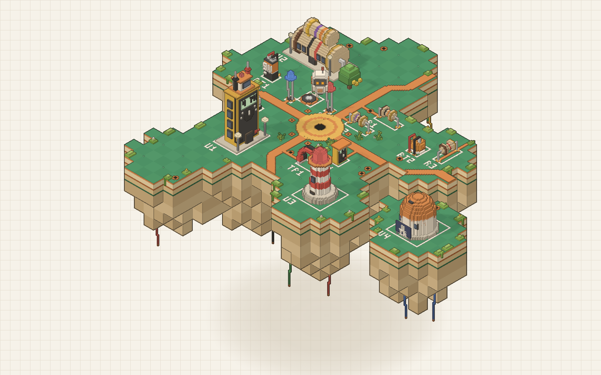
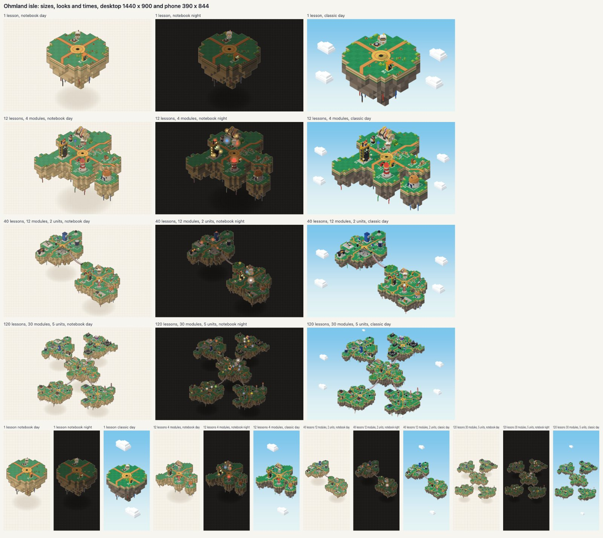

# @ohmland/isle

The learner's progress island: a floating voxel circuit board that grows a piece with every lesson and a landmark
with every module, one island per unit, linked by ribbon cable bridges (the Pitko village pattern).

- `makeIsle(seed, events)` plans it. Pure and deterministic across CPUs (seeded PRNG, fdlibm trigonometry, no
  three.js). The golden hash in `test/plan.test.ts` pins every learner's isle: only change it on purpose.
- `mountIsle(el, plan, opts)` draws it with vanilla three.js (loaded on demand): instanced meshes, an orthographic
  isometric camera, flat-shaded vertex colours. A look only changes how the plan is drawn, never the plan.



## Looks

`opts.look` picks how the isle is drawn. The default is `"notebook"`.

| | `"notebook"` (default) | `"classic"` |
|---|---|---|
| Behind the isle | Paper (`opts.paper`): `"grid"` (default), `"plain"`, or `"clear"` (a transparent canvas over the page's own paper) | A gradient sky, stars at night |
| Lines | Graphite ink: a bolder contour where the isle meets the paper, thin lines at every step, creases on close voxels | None |
| Palette | Calmer PCB green, deeper copper, slip-paper silkscreen, a keel of cream and tan FR4 | The original |
| Shadows | Light pencil shadows on the board, and each island casts a soft shadow on the page | Darker shadows, no page shadow |
| Night | The night page (#1B1A18) under a warm lamp: light graphite lines, lamps glowing amber | A starry navy sky |
| Robot | Red pencil antenna tip, amber only in its eyes, no thruster glow | Amber tip and thruster |
| Motion | Calm: see below | Lively: drifting clouds, smoke, sparks |

The notebook colours come from the Classic notebook tokens (paper, grid, ink and amber, light and dark). They are
fixed in `src/render/look.ts` (`NOTEBOOK`), so a host page using the same tokens matches.

Use `paper: "clear"` where the page already is grid paper (a card on the course map, the landing hero): the page's
own grid shows through, aligned with the rest of the page, and the isle's shadow darkens whatever paper is under it.
Use the default `"grid"` where the isle is the whole screen (`/isle`). Night follows `opts.time` (or the clock), not
the page's theme: pass a time that matches the theme if the two should agree.

### Calm motion (notebook)

- The robot hovers in place with a small, slow bob and blinks; nothing else moves on its own (no clouds, stars,
  smoke or sparks). A teaser sways 4 degrees instead of 10.
- Slow idle motion is drawn on every other frame (30 a second), so an idle isle costs half as much.
- The reveal is shorter and simpler: the camera glides to the new thing, which lands after 0.6 s (1.1 s in classic)
  and presses in like a stamp (one small overshoot, no wobble) with a small ring of paper dust. A lesson's reveal
  resolves after 1.2 s (2.0 s classic) and the camera lingers 1.8 s (2.6 s). Reduced motion shows the result at once
  in both looks.

### Labels

`opts.onPick` sends `{ title, detail, kind, x, y }` (CSS pixels, the anchor above the tapped thing). In the notebook
the host draws it as an ink slip: the slip colour (`--paper-slip`), a 1.5 px `--rule` border, 2 px corners, the
`--slip-shadow` offset shadow, the title in the serif at 600, the detail in `--ink-2`, pinned above the anchor by a
short pencil line. The playground's `#label` and reveal `#card` styles are a working example.

## Options

```ts
mountIsle(el, plan, {
  interactive: boolean,      // drag to turn, pinch or scroll to zoom (the /isle page); else a teaser
  quality: "high" | "low",   // pixel ratio cap 2 or 1.5, shadow map size
  muted: boolean,
  reducedMotion: boolean,
  look?: "notebook" | "classic",          // default "notebook"
  paper?: "grid" | "plain" | "clear",     // notebook only, default "grid"
  time?: Date, at?: number, messages?: IsleMessages, audio?: AudioContext,
  autoRotate?: number, inset?: { bottom?: number }, onPick?: (label) => void,
});
```

The view: `reveal(from, to)`, `show(k)`, `update(plan, k?)`, `setTime(date)`, `setZoom(z)`, `setInset(inset)`,
`setMuted(m)`, `clearPick()`, `pause()`, `resume()`, `resize()`, `dispose()`, and `stats()`: frame rate, the
main-thread time of a drawn frame (`workMs`), frames drawn since mounting (`drawn`), draw calls, triangles,
instances and pools.

## How the ink works

The notebook renders the scene once into a target with a depth texture, then one full-screen pass (`src/render/ink.ts`)
lays it on paper and inks it. The camera is orthographic, so depth is linear and changes at a constant rate across
any flat face: a neighbour much further away marks an outline, and a kink in the depth's slope marks a crease.
Thresholds are in world units against the size of a pixel, so lines stay one stroke wide at any zoom, and creases
fade out as the isle gets small. Nothing is drawn twice: ink costs one draw call. The target is multisampled only on
1x screens at high quality, where jagged edges would show.

## Performance

Measured with `scripts/perf.mjs` on an Apple M5 Pro (Metal), night, notebook against classic:

| Case | Notebook | Classic |
|---|---|---|
| 300 lessons, 1440 x 900 at dpr 2, CPU 4x slower, idle | 60 fps, 131 draw calls, 30 frames drawn a second | 60 fps, 135 draw calls, 60 drawn |
| 120 lessons, 390 x 844 at dpr 3 (drawn at 2), CPU 6x slower, idle | 60 fps, 122 draw calls, 30 drawn | 60 fps, 126 draw calls, 60 drawn |
| 300 lessons, turning teaser, vsync off, dpr 2 | 688 fps | 702 fps |
| 300 lessons, turning teaser, vsync off, dpr 1 (multisampled) | 670 fps | 689 fps |
| 40 lessons, 390 x 844 at dpr 2, SwiftShader (a slow GPU), turning | 60 fps | 35 fps |

A frame the notebook draws costs within about 3 % of a classic one; it draws half as many when idle and fewer draw
calls (no sky, clouds, stars, smoke or sparks; one ink pass and one call for all the page shadows). On SwiftShader
the notebook's multisampled path (dpr 1 only) is slow, as SwiftShader emulates sRGB multisampling; real GPUs do it
in hardware.

## Playground and scripts

```sh
pnpm --filter @ohmland/isle dev      # the playground: sizes, looks, paper, time, reveals, stats
pnpm --filter @ohmland/isle test     # the plan: determinism, golden hash, no overlaps, no three.js in the planner
pnpm --filter @ohmland/isle shots    # screenshots: 1, 12, 40, 120 lessons, notebook day and night and classic day,
                                     # desktop and phone, plus a contact sheet (screenshots/out, not committed)
node scripts/perf.mjs [--look notebook,classic] [--turn 6] [--uncapped] [--swiftshader] [--size 390x844 --dpr 3]
```

Playground query parameters: `l`, `m`, `u`, `seed`, `time` (auto, day, dusk, night), `q` (high, low), `look`,
`paper`, `rm=1` (reduced motion), `muted=0`, `bare=1`, `zoom`, `only` (one unit's island), `turn` (a turning teaser).
`/robot.html` shows the robot alone (`?night=1`, `?look=classic`).

## Screenshots

Curated in `screenshots/`: the contact sheet of every size, look and time on desktop and phone
(`contact-sheet.jpg`), the notebook at 12 lessons by day and night, the 120-lesson archipelago, the first lesson and
40 lessons at night on a phone, a module reveal, the robot, and the classic look at 12 lessons for comparison.


